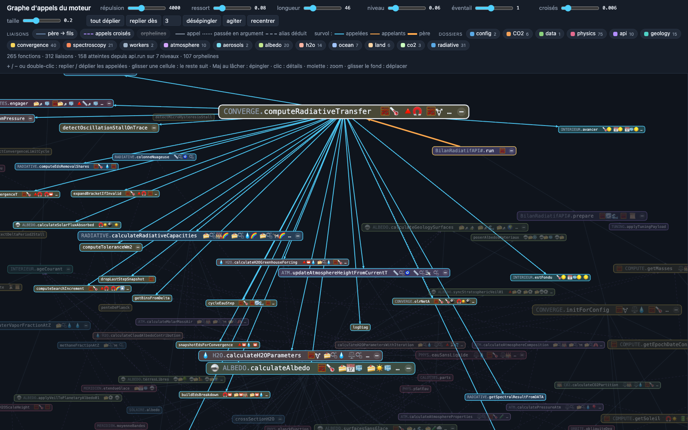

# API_BILAN — Bilan radiatif

Modèle 0D du bilan radiatif terrestre, en JavaScript pur : aucune dépendance externe, aucun DOM dans
les calculs. Entrée : une époque géologique ou une configuration. Sortie : température de surface, flux,
spectres — via Promise et callbacks synchrones.

Le modèle couvre 19 époques, du corps noir sans atmosphère à 2100, avec les deux grandes hystérésis
glace-albédo (Snowball néoprotérozoïque, calotte antarctique) et les cycles glaciaires du Quaternaire.

> **Démo exécutable et banc de référence : [`demo/epoch_bench.html`](demo/epoch_bench.html)** — il charge
> la pile complète, fait tourner les 19 époques et compare aux fourchettes de la littérature. C'est
> l'intégration de référence : en cas de doute, c'est ce fichier qui fait foi, pas ce README.
>
> **Pour manipuler une époque : [`demo/scie_compute.html`](demo/scie_compute.html)** — la frise
> charge la configuration d'une époque, les champs la rendent modifiable (température attendue,
> masses, orbite), et ▶️ fait converger. Même moteur, même résultat que le banc : l'Archéen y
> donne 18,748 °C dans les deux.
>
> **Pour voir comment le moteur s'enchaîne : [`demo/graphe.html`](demo/graphe.html)** — le graphe
> d'appels, lu dans le code (ci-dessous).

---

## Graphe d'appels



Le moteur décrit lui-même son algorithme. `graphe/` charge les scripts du manifeste et note ce que
chacun pose sur `window`. Il lit ensuite le source de chaque fonction (`Function.prototype.toString`)
pour y relever trois choses :

- ses **appels** : appels directs (`calculateT0(…)`, `window.calculateFluxForT0(…)`), membres de
  module (`ALBEDO.calculateAlbedo`, un alias local `const S = window.SAISONS`), `this.…` dans un
  module ;
- les **fonctions qu'elle passe en argument** (`INTERIEUR.avancer(olrNetA)`, `map(continuumH2OCs)`) ;
- les **clés du dico** qu'elle lit ou écrit (`DATA['🪩']['🍰🪩🧊']`), avec leur sens tiré de `DESC`.

Une variable locale qui porte le nom d'une globale la masque, comme en JavaScript. Aucune liste n'est
écrite à la main : une fonction ajoutée au moteur apparaît dans le graphe, une fonction retirée en
disparaît.

- **265 fonctions, 312 liaisons.** 158 fonctions sont atteintes depuis
  `BilanRadiatifAPI.prototype.run`, sur 7 niveaux. Les 107 autres sont des « orphelines » :
  diagnostics, bancs, accesseurs que `run` n'appelle pas.
- **Arbre** (`graphe/graphe_arbre.js`) : parcours en largeur depuis `run`. Chaque fonction a pour
  père le premier appelant qui l'atteint (plus court chemin). Ses fils sont rangés dans l'ordre où le
  source les appelle. Les autres appels restent des liens croisés.
- **Liens.** La couleur dit le type de liaison : bleu pour père → fils, violet tireté pour un appel
  croisé. Le trait dit la nature : plein pour un appel, pointillé fin pour une fonction passée en
  argument, tirets longs pour un alias déduit. Au survol, les appelées passent en cyan, les appelants
  en orange, et le père en orange épais.
- **Cellules.** Le logo de l'alphabet précède le nom quand l'alphabet nomme le module
  (`CHARS.ALBEDO` = 🪩), puis viennent les trois clés du dico les plus citées. La taille grandit avec
  le nombre de fils (1 + taille × √fils).
- **Disposition dynamique** (`demo/js/graphe_forces.js`) : les cellules se repoussent (charge en
  1/d², d mesurée de bord à bord, plus la collision de leurs rectangles). Des ressorts les lient à
  leur père et à leurs fils, et plus faiblement à ce qu'elles appellent hors de l'arbre. Plus un père
  a de fils, plus ils s'en écartent : le ressort ne descend pas sous le rayon où ils tiennent côte à
  côte (somme de leurs tailles / 2π, curseur « éventail »).
- **Interaction.** Le bouton +/− ou un double-clic replie ou déplie les appelées. Glisser une cellule
  entraîne ses voisines, et Maj au lâcher l'épingle. Les légendes sont des boutons on/off : liens
  d'arbre, liens croisés, orphelines, et chaque dossier du moteur (les fils d'un dossier masqué se
  rattachent au plus proche ancêtre visible). Un clic sur une cellule ouvre son fichier, ses
  appelants, ses appelées, ses clés du dico et son source.
- **Mémoire** (`demo/js/graphe_memoire.js`) : au F5, la vue reprend là où elle était. Elle garde dans
  localStorage les positions, les cellules épinglées et repliées, la caméra, les légendes et les
  curseurs. Sans mémoire, tout est déplié ; « réinitialiser » revient à cette vue de départ. Une
  fonction apparue dans le moteur entre-temps jaillit de son père.

Ce que le graphe ne voit pas : les fonctions privées des modules (fermées dans un IIFE, jamais posées
sur `window`), et donc les appels qui passent par elles. Un alias posé hors de la fonction, au niveau
de l'IIFE (`const A = window.astronomie`), n'est pas lisible non plus : `A.orbite` est résolu, en
« alias déduit », seulement quand un seul module a un membre `orbite`.

```js
// Depuis n'importe quel hôte : relever pendant le chargement, extraire après.
const relever = GRAPHE_EXTRACTION.releveur(apiBase, before.length);
BILAN_LOADER.load({ apiBase, before, after, cacheBust: '', onLoaded: relever }).then(function () {
    GRAPHE_EXTRACTION.extraire();   // GRAPHE.noeuds : appels, natures, appelants, logo, cles, source
    GRAPHE_ARBRE.construire();      // parent, enfants, profondeur, croises, GRAPHE.racines
});
```

---

## Intégration

### 1. Charger les scripts, dans cet ordre

L'ordre est celui des dépendances, pas une préférence. Il est repris tel quel de `demo/epoch_bench_loader.js`.

```html
<!-- Config et structure de DATA -->
<script src="API_BILAN/config/model_tuning_biblio.js"></script>
<script src="API_BILAN/config/configTimeline.js"></script>
<script src="API_BILAN/data/alphabet.js"></script>
<script src="API_BILAN/data/dico.js"></script>
<script src="API_BILAN/data/initDATA.js"></script>
<script src="API_BILAN/config/fine_tuning_bounds.js"></script>

<!-- Physique et spectroscopie -->
<script src="API_BILAN/physics/physics.js"></script>
<script src="API_BILAN/data/hitran_lines_CO2.js"></script>
<script src="API_BILAN/data/hitran_lines_H2O.js"></script>
<script src="API_BILAN/data/hitran_lines_CH4.js"></script>
<script src="API_BILAN/spectroscopy/hitran.js"></script>
<script src="API_BILAN/physics/climate.js"></script>
<script src="API_BILAN/radiative/calculations.js"></script>
<script src="API_BILAN/workers/worker_pool.js"></script>

<!-- Modules de calcul -->
<script src="API_BILAN/h2o/calculations_h2o.js"></script>
<script src="API_BILAN/aerosols/sulfate_ccn.js"></script>
<script src="API_BILAN/albedo/calculations_albedo.js"></script>
<script src="API_BILAN/atmosphere/calculations_atm.js"></script>
<script src="API_BILAN/ocean/sinks_ocean.js"></script>
<script src="API_BILAN/land/sinks_land.js"></script>
<script src="API_BILAN/co2/calculations_co2.js"></script>

<!-- Orchestration -->
<script src="API_BILAN/convergence/compute.js"></script>
<script src="API_BILAN/convergence/calculations_flux.js"></script>
<script src="API_BILAN/tuning.js"></script>
<script src="API_BILAN/api.js"></script>
```

Scripts classiques, pas de modules ES : les pages doivent pouvoir s'ouvrir en `file://`.

> ⚠️ Il n'y a plus de bundle. `configsAll.js` est un **stub** depuis la v1.2.0 (il ne fait que crier si
> on le charge seul) et `physicsAll.js` **n'existe plus**. Les versions de ce README antérieures à
> septembre 2026 en donnaient un copier-coller : il ne peut pas fonctionner.

### 2. Fournir le contrat hôte

Le moteur se charge par `loader/loader.js` (liste unique : `loader/engine_manifest.js`). Une page sans
interface charge avant lui `demo/js/demo_host.js`, qui pose le strict nécessaire :

```js
window.debugMirrorConfigLogToFile = function () {};   // miroir fichier des journaux CONFIG_COMPUTE.log*
```

`SYNC_STATE` et `ABORT_COMPUTE` (passer à `true` pour interrompre un run) naissent dans `data/initDATA.js`.

Tout le reste passe par le callback de l'API (un seul canal) : `convergenceStart`, `convergenceStep`,
`convergenceRefresh`, `cycleCalcul` (le moteur ATTEND la valeur rendue : une promesse le fait patienter,
c'est ainsi que la visu dessine pas à pas) et `ProcessFinished`.

### 3. Lancer un calcul

```js
function onStep(event, payload) {
    if (event === 'ProcessFinished') {
        var T = payload.DATA['🧮']['🧮🌡️'];
        console.log('Température de surface :', (T - 273.15).toFixed(1) + ' °C');
    }
}

var api = window.getBilanRadiatifAPI(onStep);   // singleton ; new BilanRadiatifAPI(cb) donne la même instance

api.run({ epochId: '🚂', animEnabled: false }).then(function (result) {
    console.log('Calcul terminé', result);
});
```

Quelques secondes par époque. `api.run()` ne remet pas à zéro les compteurs de l'époque
(`DATA['📜']['📿💫']`, `['📿☄️']`) : c'est ce qui permet de rejouer un état précis, clic par clic.

---

## Époques

`epochId` = clé `'📅'` de `window.TIMELINE`. « Clics » = nombre d'événements pour traverser l'époque
(`🕰.order`, ou durée ÷ `🔺⏳`).

| epochId | Époque | De | À | Clics | Événements |
|---|---|---|---|---|---|
| `'⚫'` | Corps noir | — | — | 5 | ☄️ 💫 🎇 |
| `'🔥'` | Hadéen | 4,50 Ga | 4,00 Ga | 5 | 💫 ☄️ |
| `'🦠'` | Archéen | 4,00 Ga | 2,50 Ga | 3 | 💫 |
| `'🪸'` | Protérozoïque | 2,50 Ga | 750 Ma | 3 | 💫 |
| `'hysteresis 1a'` | Entrée sturtienne | 750 Ma | 720 Ma | 1 | 🗻 |
| `'⛄'` | Plein Snowball | 720 Ma | 690 Ma | 2 | 💫 🌋 |
| `'hysteresis 1b'` | Sortie marinoenne | 690 Ma | 600 Ma | 1 | 💫 |
| `'🪼'` | Paléozoïque marin | 600 Ma | 420 Ma | 1 | 💫 |
| `'🍄'` | Paléozoïque terrestre | 420 Ma | 280 Ma | 4 | 💫 (3 états `🔁`, Karoo) |
| `'💀'` | Extinction permienne | 280 Ma | 250 Ma | 1 | 💫 |
| `'🦕'` | Mésozoïque | 250 Ma | 66 Ma | 2 | 💫 🎇 |
| `'🦤'` | Cénozoïque | 66 Ma | 50 Ma | 1 | 💫 |
| `'🐊'` | Éocène | 50 Ma | 35 Ma | 1 | 💫 |
| `'hysteresis 2'` | Éocène–Oligocène | 35 Ma | 33 Ma | 1 | ⛰ |
| `'🏔'` | Grande Coupure → Pliocène | 33 Ma | 2 Ma | 2 | 💫 |
| `'🦣'` | Quaternaire | 2 Ma | 10 ka | 4 | 💫 (3 états `🔁`, Milankovitch) |
| `'🛖'` | Holocène | −10 ka | 1800 | 3 | 💫 |
| `'🚂'` | Ère industrielle | 1800 | 2000 | 2 | 💫 |
| `'📱'` | Aujourd'hui | 2000 | 2100 | 4 tranches | ⛽ 🛢 (par année) |

Le corps noir n'est pas une époque géologique mais le point de départ du raisonnement : une bille de
roche sans air ni eau, à −18 °C.

---

## Tuning : le barycentre d'incertitude 🧩

Le modèle dépend de paramètres MESURÉS dont la valeur exacte est incertaine (gouttes, seuil de pluie et
fractions des nuages, humidité de surface, effet sulfate). Plutôt que d'en figer un jeu arbitrairement, une
**jauge [0–100 %]** interpole entre les bornes de la littérature, déclarées avec leur source dans
`config/fine_tuning_bounds.js` ; chaque paramètre lit SA jauge (`target.baryGroup`) :

- **FROID**, **CHAUD** : **100 %** → la valeur la plus réchauffante de chaque plage (monter la jauge réchauffe)
- **SUBTIL** : **100 %** → borne haute (le sens dépend de l'époque)

Il n'y a pas de « valeur nominale » cachée : le défaut est un point du segment, pas une exception.

| Jauge | Paramètres | Défaut |
|---|---|---|
| **FROID** ☁️ | nuages bas : gouttes sur océan (CDNC), seuil de pluie, fraction de nuages bas — refroidissent quand ils augmentent | 50 % |
| **CHAUD** 🌥 | fraction de nuages hauts, humidité relative de surface — réchauffent | 50 % |
| **SUBTIL** | exposant sulfate → gouttes (signe selon l'époque) | 70 % |

Les jauges règlent la HAUTEUR de la courbe du modèle, pas sa forme : le défaut est un point de chaque segment
(`DATA['🎚️'].baryByGroup`, `data/initDATA.js`).

```js
api.run({ epochId: '🚂', animEnabled: false, tuning: { baryByGroup: { FROID: 50, CHAUD: 50, SUBTIL: 70 } } });
```

> Le groupe **SOLVER** n'existe plus comme barycentre : les paramètres de convergence sont statiques
> et vivent dans `window.CONFIG_COMPUTE` (`config/configTimeline.js`).

---

## Entrée / sortie

### `api.run(config)`

| Forme | Description |
|---|---|
| **Objet** | `{ epochId?, animEnabled?, ticTime?, tuning? }` |
| **String** | Identifiant d'époque seul (ex. `'🚂'`) |
| **Rien** | Époque par défaut `'⚫'` |

- **`epochId`** — clé d'époque dans `TIMELINE`.
- **`animEnabled`** — si `false`, la graine de température est celle de l'époque (`'🌡️🧮'`), pas la
  température courante. C'est le mode du banc : chaque époque part de la même amorce. En animation,
  l'état précédent est conservé — nécessaire pour voir une hystérésis.
- **`ticTime`** — pas de temps pour l'animation.
- **`tuning`** — voir ci-dessus.

### Sortie

- **Promise** — résout avec le résultat du calcul, ou `null` si le run a été abandonné.
- **Callback** `(event, payload)` :

| Événement | Quand |
|---|---|
| `'convergenceStep'` | à chaque pas du solveur |
| `'cycleCalcul'` | à chaque cycle (eau, albédo, radiatif) |
| `'ProcessFinished'` | fin du calcul — `payload.DATA` et `payload.result` |

Statut de sortie dans `DATA['🧮']['🧮🛑']` (`'converged'`, `'abort'`…).

Un seul callback : celui passé à `getBilanRadiatifAPI(cb)` (le dernier donné gagne, l'API est un singleton).

---

## Alphabet et dictionnaire des clés

Les données sont indexées par des emojis (`'🌡️'` température, `'⚖️'` masse, `'🍰'` fraction…). La
référence rédigée — alphabet, catégories, formules par clé — est dans
**[doc/ALPHABET_ET_DICO.txt](doc/ALPHABET_ET_DICO.txt)** ; les définitions exécutables sont dans
`data/alphabet.js` et `data/dico.js`.

Le RENDU de ces définitions — grille du lexique, pictos PNG, helpers de logo — n'est pas ici : il vit
dans le dépôt CO2 (`static/compute/alphabet_render.js`, `dico_render.js`). L'API définit, l'application
dessine.

---

## Fichiers

| Fichier / dossier | Rôle |
|---|---|
| **api.js** | `BilanRadiatifAPI`, `run({ epochId, animEnabled })` → Promise ; `window.getBilanRadiatifAPI(cb)` |
| **tuning.js** | Interpolation du barycentre → `DATA['🎚️']` |
| **convergence/clics.js** | `CLICS` — la mécanique des clics (frise, passage d'époque, actions) |
| **loader/** | `engine_manifest.js` (la liste des scripts du moteur) + `loader.js` (`BILAN_LOADER`) |
| **configsAll.js** | Stub — ancien bundle, retiré ; charger les sources séparément |
| **config/** | `configTimeline.js` (époques + `CONFIG_COMPUTE`), `fine_tuning_bounds.js`, `model_tuning.js`, `model_tuning_biblio.js` |
| **data/** | `alphabet.js` (CHARS, CHARS_DESC), `dico.js` (KEYS, DESC, FORM), `initDATA.js`, `hitran_lines_*.js` |
| **physics/** | Constantes et lois (Planck, Stefan-Boltzmann), `climate.js` |
| **spectroscopy/** | Sections efficaces HITRAN, profil de Voigt |
| **atmosphere/** | Structure verticale, pression, fractions molaires |
| **albedo/** | Albédo de surface, glace, nuages, voile stratosphérique |
| **h2o/** | Vapeur d'eau, nuages, partition liquide/glace |
| **co2/** | Pompe océanique (Henry/Revelle), puits forêts |
| **geology/** | Surfaces géologiques par époque |
| **radiative/** | Transfert radiatif couche par couche |
| **convergence/** | `compute.js` (masses, config d'époque), `calculations_flux.js` (solveur) |
| **workers/** | Pool de web workers pour le calcul spectral (N−1 threads) |
| **graphe/** | Graphe d'appels du moteur, lu dans son code : `graphe_appels.js` (`GRAPHE_EXTRACTION`), `graphe_arbre.js` (`GRAPHE_ARBRE`) |
| **doc/** | Documentation détaillée : formules, algorithmes, bibliographie |
| **demo/** | Pages exécutables : banc d'époques, vue scientifique, graphe d'appels, alphabet, dictionnaire — le dépôt se teste sans CO2 |

Découpage détaillé par catégorie de calcul : **[STRUCTURE.md](STRUCTURE.md)**.

---

## Parallélisme

`workers/worker_pool.js` ouvre `navigator.hardwareConcurrency − 1` workers pour le calcul spectral,
plafonnables par `CONFIG_COMPUTE.maxWorkers`.

Attention : certains navigateurs **sous-déclarent** ce nombre. Brave le randomise (protection
anti-empreinte dite *farbling*) : la valeur est inférieure au nombre réel de cœurs et change d'une
session à l'autre, donc les temps de convergence varient sans raison apparente. Chrome et Edge
annoncent le nombre réel.

---

## Conventions de code

Obligatoires pour toute contribution — humaine ou assistée.

1. **Globals `window.NOM_EN_MAJUSCULE`.** Les objets partagés (`DATA`, `EARTH`, `CONFIG_COMPUTE`,
   `CONST`…) sont des données vivantes. En entrée de fonction, une seule liaison locale
   (`const DATA = window.DATA`) plutôt que des accès `window.*` éparpillés.
2. **`window.` + identifiant minuscule** : suspect par défaut. L'exposition globale passe par des
   objets MAJUSCULE, sauf exception documentée.
3. **Crash-first.** Pas de garde silencieuse ni de repli sur une valeur plausible : si un prérequis
   manque, l'erreur doit être visible. C'est pour ça que le contrat hôte ci-dessus est explicite.
4. **Éviter les `if` abusifs** : privilégier un chemin unifié quand c'est possible.
5. **Un fichier = une responsabilité**, scripts classiques, en-tête `File / Desc / Version / Date /
   Copyright` dans chaque fichier, et un log de version à chaque modification.

---

## Documentation

Index complet — algorithmes, formules, physique, convergence, diagnostic, bornes du tuning :
**[doc/README.md](doc/README.md)**.

---

## Licence

Apache License 2.0 avec Commons Clause. Copyright DNAvatar.org — Arnaud Maignan.
